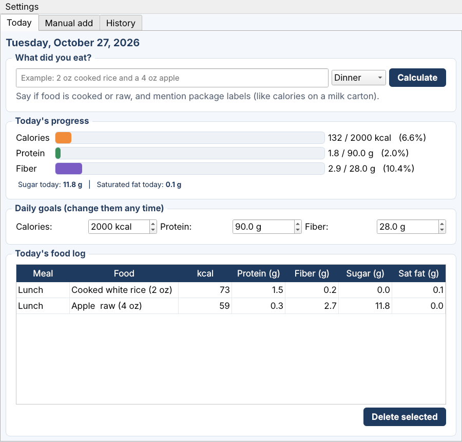

# Nutrition Goal Tracker - Version 1 (C++ / Qt + Claude)

A desktop app where you **say what you ate in plain words** and it works out calories, protein,
fiber, sugar and saturated fat for you.

> "2 oz cooked rice and a 4 oz apple"  ->  nutrition numbers added to today's log



## What is new in version 1
- Type a sentence instead of looking up numbers. The app understands cooked vs raw, units
  (oz, cups, ml, pieces), and package label numbers you mention (for example a Costco milk label).
- Shows **sugar** and **saturated fat** for the day, along with calories, protein and fiber.
- Before anything is saved, you see the numbers and what was assumed, then choose Yes or No.
- A "Manual add" tab still works without internet.
- Older save files (version 0) still load.

## How it works
1. You type a sentence and click **Calculate**.
2. `ClaudeClient` sends it to the Claude API and asks for the answer as JSON.
3. The app reads the JSON, checks the numbers, and shows them for confirmation.
4. `Tracker` saves the foods and adds them to your daily totals and history.

## Your API key (keep it secret)
The app needs a Claude API key. Enter it in the app under **Settings -> Set API key...**.
It is saved only on your own computer and is **never** written into the code or this repository.
Never paste your key into a file you upload to GitHub.

## Concepts used
- Object-oriented programming (`FoodEntry`, `Tracker`, `ClaudeClient`, `MainWindow`)
- Calling a web API from C++ with Qt Network, and reading JSON
- Input validation and error handling (bad key, no internet, unreadable answers)
- Qt Widgets: layouts, tables, progress bars, signals and slots
- Saving and loading data with backward compatibility

## Build and run
See `SETUP.md` for step-by-step instructions (install Qt, open `CMakeLists.txt`, click Run).

## Project structure
```
src/
  main.cpp             starts the app
  MainWindow.h / .cpp  the window, buttons and confirmation step
  ClaudeClient.h / .cpp  sends the sentence to Claude and reads the answer
  FoodEntry.h / .cpp   one logged food
  Tracker.h / .cpp     goals, entries, totals, saving and loading
CMakeLists.txt
```

## Important
Nutrition numbers are **estimates** made by an AI. This app is a tracking tool, not medical or
dietary advice. Anyone with diabetes, high cholesterol or another health condition should ask their
doctor or a dietitian.

## Author
Rahenuma Begum - Computer Science, Webster University
